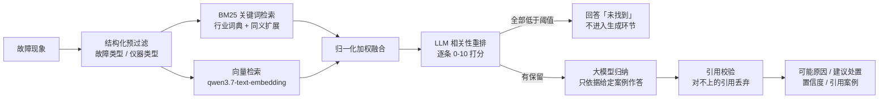
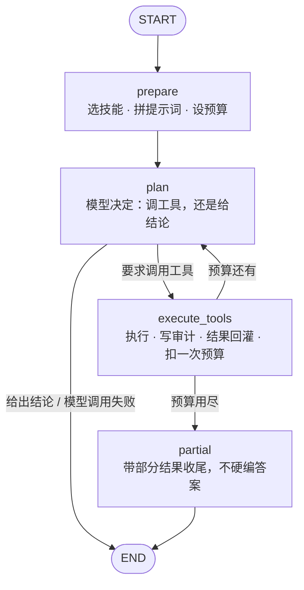

# 剪切阀脉冲器全生命周期管理系统（网络版）

给能源装备企业做的设备全生命周期管理系统（网络版）。单机版用 tkinter 加 SQLite、装在每台电脑上；
这一版把数据集中到服务器，改成浏览器访问，设备台账、使用记录、维保工单、故障记录与耗材库存
由各岗位共用同一份数据，并增加权限控制与审计日志。

## 目录结构

| 路径 | 内容 |
| --- | --- |
| `docs/` | 方案文档，见下表 |
| `dev/` | 开发环境编排，只跑 MySQL，后端与前端在本机运行 |
| `开发日志/` | 每个阶段的开发日志，按天或按提交追加 |

`docs/` 里放的是两张流程图：Agent 编排状态图（`agent-workflow.mmd` 与导出的 `.png`）与
故障诊断链路图（`diagnosis-workflow.png`），都由 `backend/eval/export_graph.py` 从编译后的图导出。

## 开发环境

需要 Python 3.10 以上、Node、Git 和 Docker Desktop（WSL2 后端）。

### 一键启动（推荐）

在任意目录打开 PowerShell 执行：

```
powershell -ExecutionPolicy Bypass -File C:\codex_project\update_for_single\dev\start-dev.ps1
```

脚本按顺序做三件事：拉起 MySQL 容器并等它健康 → 启动后端（8000）→ 启动前端（5173），
最后打印访问地址与开发账号。默认每个服务各开一个可见窗口，日志直接看得到、Ctrl+C 即可停；
加 `-Hidden` 则后台运行，日志写到 `dev\logs\`。

常用参数：`-Restart`（端口被占用时先停掉占用者再启动）、`-SkipDocker`、`-SkipBackend`、
`-SkipFrontend`、`-WithMcp`（额外启动 MCP 的 HTTP 传输，127.0.0.1:8001）。

停止：

```
powershell -ExecutionPolicy Bypass -File C:\codex_project\update_for_single\dev\stop-dev.ps1            # 只停三个服务
powershell -ExecutionPolicy Bypass -File C:\codex_project\update_for_single\dev\stop-dev.ps1 -WithDocker # 连数据库一起停
```

> **开发服务必须由你自己的终端拉起。** 挂在别的进程（编辑器、助手会话）上的服务，
> 宿主被回收时会跟着消失，表现就是"用着用着突然打不开了"。脚本启动的进程独立于任何会话，
> 这也是它存在的理由。

开发数据库是容器里的 MySQL 8.0，映射到宿主机 3307：

```
docker compose -f dev/docker-compose.dev.yml up -d      # 起库
docker compose -f dev/docker-compose.dev.yml logs -f    # 看日志
docker compose -f dev/docker-compose.dev.yml down       # 停库
```

连接信息：`127.0.0.1:3307`，库 `pulse_lifecycle_dev`，用户 `pulse_dev`。
本机若另装了 MySQL 8.4，它占用 3306，两者互不干扰。

## 后端

后端在 `backend/` 目录，FastAPI + SQLAlchemy 2.x + Alembic，要求 Python 3.10 以上。

首次准备（在 `backend/` 目录下执行）：

```
python -m venv .venv
.venv\Scripts\python.exe -m pip install -r requirements-dev.txt
copy .env.example .env
```

启动开发服务与运行测试：

```
.venv\Scripts\python.exe -m uvicorn app.main:app --reload --port 8000
.venv\Scripts\python.exe -m pytest
```

接口文档在 `http://127.0.0.1:8000/docs`，健康检查在 `http://127.0.0.1:8000/api/v1/health`。

## 智能运维助手（RAG）

在既有业务系统上增加故障案例检索与诊断，代码在 `backend/app/ai/`（语料、检索、生成层）。

| 接口 | 说明 | 权限 |
| --- | --- | --- |
| `POST /api/v1/ai/diagnosis` | 输入故障现象，返回可能原因、建议处置与引用案例 | `fault.view` |
| `POST /api/v1/ai/ask` | 自然语言数据问答，模型自己决定调哪些工具 | 登录即可，数据按工具粒度鉴权 |
| `GET /api/v1/ai/corpus/stats` | 语料规模与来源构成 | `system.settings` |

诊断链路（`POST /ai/diagnosis`）是一条带分支的流水线：



两条抗幻觉约束就落在图的两处分支上：**检索或重排为空时不调用模型**，直接回答未找到；
**模型给出的引用必须能在本次检索结果里对上**，对不上的丢弃，一条不剩时置信度强制降为「低」。

生成层用 **langchain-openai 的 `ChatOpenAI`** 调用（协议仍是 OpenAI 兼容，默认 DeepSeek），
Key 放在 `backend/.env`（不入库）；换模型只改 `base_url` 与模型名，
DeepSeek 生成 + 通义向量现在就是这样并存。
**没有 Key 或模型超时、报错时接口自动降级为只返回相似案例列表**，不影响页面可用。

检索质量可以用 40 条口语描述评测（在 `backend/` 下执行）：

```
.venv\Scripts\python.exe eval\retrieval_eval.py          # 行业词典 + 同义词扩展
.venv\Scripts\python.exe eval\retrieval_eval.py --plain  # 基线，用于对比
.venv\Scripts\python.exe eval\diagnosis_eval.py          # 端到端：原因匹配率、无结果准确率、延迟、token
.venv\Scripts\python.exe eval\diagnosis_eval.py --no-model   # 不调用模型，只跑无结果准确率
```

### 指标（2026-10-09，开发库 + 仿真语料）

| 指标 | 数值 | 口径 |
| --- | --- | --- |
| Recall@1 / @3 / @5（关键词检索） | 92.5% / 97.5% / 97.5% | 40 条口语描述查规范案例，标准答案即案例自身 |
| 同口径基线（无行业词典、无同义扩展） | 47.5% / 50.0% / 52.5% | 同一脚本加 `--plain`，用于对比 |
| 故障类型命中@3 | 97.5% | Top-3 里出现同类型案例 |
| 原因匹配率（首位 / 前三位） | **95.0% / 100%** | 端到端（混合检索 + 重排），模型给出的原因与标准原因一致 |
| 无结果准确率 | 100% | 10 条域外问题，正确回答"未找到"且不进入生成环节（开启重排后） |
| P50 / P95 延迟 | 3.59s / 4.20s | 端到端，含查询向量化、重排与模型调用 |
| token 用量（均值） | 生成 395 + 150，重排 720 | 单次诊断；成本要把向量与重排一起算 |

两条口径说明，写在文档里比藏着强：**评测集与行业词典同源**（同一批仿真案例），数字偏乐观，
真实故障数据迁移到位后要改用留出法重测。

### 相关性重排（解决同词异义）

BM25 只看字面，救不了"软件著作权"与"地面软件"这种撞词。本项目的模型服务没有 embedding 接口，
本地跑向量模型要装 torch 并下载模型，所以这里用**对话模型做重排**：对候选逐条打分（0-10），
低于阈值直接丢掉；一条都不剩就按"未找到"处理，不再进入生成环节。

| 指标 | 关闭重排 | 开启重排 |
| --- | --- | --- |
| 无结果准确率 | 90.0% | **100%** |
| 原因匹配率（首位 / 前三位） | 92.5% / 97.5% | 92.5% / 97.5%（未退化） |
| P50 / P95 延迟 | 1.69s / 1.98s | 3.10s / 4.00s |
| 单次 token | ≈459 | ≈753（含重排） |

**代价是延迟翻倍、token 增加约六成**，换来抗幻觉能力。所以它是配置开关（`AI_RERANK`），
对延迟敏感的场景可以关掉。重排失败一律放行（fail-open）——它是精度优化，不该让诊断整体不可用。
`Reranker` 是协议，将来换成向量检索或专用重排模型只需再加一个实现。

### 向量检索（可选，与关键词融合）

检索层支持三种模式，用 `EMBEDDING_PROVIDER` 切换，**默认 `none` 只用关键词**：

| 模式 | 配置 | 说明 |
| --- | --- | --- |
| 关键词 | `EMBEDDING_PROVIDER=none` | 默认，零依赖，BM25 + 行业词典 + 同义扩展 |
| 向量（API） | `EMBEDDING_PROVIDER=api` + `EMBEDDING_API_KEY` | OpenAI 兼容的 `/embeddings`；默认用通义 `qwen3.7-text-embedding`（256~2560 维可自定义），同源 `text-embedding-v4` 与智谱 `embedding-3` 也兼容 |
| 向量（本地） | `EMBEDDING_PROVIDER=local` | 未内置实现：需要"语料不出内网"时接 `langchain-huggingface` 的 `HuggingFaceEmbeddings`，实现同一个 `Embedder` 协议即可 |

开着向量时是**混合检索**：两路各取若干候选，归一化后加权融合（`AI_VECTOR_WEIGHT` 可调，
默认各占一半），融合分数就是页面上显示的"匹配度"。几个工程细节：

- 语料向量**按指纹缓存**，键里带模型名——换模型自动重建，不会拿旧维度的向量算相似度；
- 向量化失败**记冷却时间**（默认 60 秒），避免每个请求都白等一次超时；这期间退回纯关键词；
- 查询向量化失败只影响这一路，关键词检索照常出结果，响应里 `retrieval.mode` 与 `note` 说明当前用的哪条路；
- 结构化过滤（故障类型、仪器类型）在向量侧同样生效，条件过窄时与关键词侧一致地放宽。

配置好之后先自检，再跑评测（都在 `backend/` 下执行）：

```
.venv\Scripts\python.exe eval\probe_embedding.py   # 验 key、模型名、维度、延迟与相似度区分度
.venv\Scripts\python.exe eval\diagnosis_eval.py    # 全链路指标（含检索通道统计）
```

### 五组配置的实测对比（真实 qwen3.7-text-embedding + DeepSeek，40 条案例 + 10 条域外问题）

| 配置 | 无结果准确率 | 首位原因命中 | 前三位覆盖 | P50 延迟 | 单次 token |
| --- | --- | --- | --- | --- | --- |
| 关键词（BM25 + 词典 + 同义扩展） | 90.0% | 92.5% | 97.5% | 1.69s | ≈459 |
| 纯向量 | 0.0% | 80.0% | 100% | 1.90s | ≈681 |
| 混合（关键词 + 向量） | 0.0% | **95.0%** | 100% | 2.14s | ≈677 |
| 关键词 + 重排 | 100% | 92.5% | 97.5% | 3.10s | ≈753 |
| **混合 + 重排（生产配置）** | **100%** | **95.0%** | **100%** | 3.59s | ≈1265 |

三条结论，都被数据钉住了：

1. **向量单独用会把"未找到"能力打没。** 余弦相似度永远大于 0，任何查询都会返回一个"最像"的案例——
   无结果准确率从 90% 掉到 **0%**，抗幻觉失效。这是纯向量检索最容易被忽略的坑。
2. **向量确实提升排序**：首位原因命中 92.5% → 95.0%，前三位覆盖 97.5% → 100%。
3. **重排是那道相关性闸门**：只有"混合 + 重排"同时拿到最好的排序与 100% 的无结果准确率。
   所以生产配置是两者叠加，不是二选一。

`eval/diagnosis_eval.py` 里 `--no-vector` / `--vector-only` / `--no-rerank` 三个开关可以把上表逐格复现。

### Agent 工具与技能

`/ai/ask` 走 LangGraph 状态图编排（最多 5 步）：模型决定调哪个工具、结果回灌、信息够了再作答。
工具全部复用现有 service，**用户没有权限的工具根本不会出现在模型可见的清单里**，每次调用都写审计日志
（`object_type=ai_tool`）。

技能按需加载，避免把全部指令塞进提示词：

```
app/ai/skills/<技能名>/SKILL.md      # frontmatter 声明用途与触发词，正文是流程与约束
app/ai/skills/<技能名>/references/   # 参考资料，被显式引用时才读入上下文
```

常驻提示词里只有一行一个的技能索引，命中触发词才展开正文；返回体里的 `context_chars` 可以看到省了多少。

### MCP Server

同一套工具定义还有第二个出口：MCP。外部客户端（Claude Code、Codex、Cursor 等）可以直接挂载。

#### 启动

```
cd backend
.venv\Scripts\python.exe -m app.mcp.server                                       # stdio，给本地客户端
set MCP_TRANSPORT=streamable-http && .venv\Scripts\python.exe -m app.mcp.server  # 内网 HTTP，默认 127.0.0.1:8001
```

| 环境变量 | 默认 | 说明 |
| --- | --- | --- |
| `MCP_TRANSPORT` | `stdio` | `stdio` 或 `streamable-http` |
| `MCP_USERNAME` | `admin` | **仅 stdio** 使用的服务账号 |
| `MCP_REQUIRE_TOKEN` | `true` | HTTP 传输是否必须带访问令牌；设 `false` 只用于本机调试 |
| `MCP_HOST` / `MCP_PORT` | `127.0.0.1` / `8001` | HTTP 监听地址 |

#### 客户端配置（stdio）

```json
{
  "mcpServers": {
    "pulse-lifecycle": {
      "command": "C:\\codex_project\\update_for_single\\backend\\.venv\\Scripts\\python.exe",
      "args": ["-m", "app.mcp.server"],
      "cwd": "C:\\codex_project\\update_for_single\\backend",
      "env": { "PYTHONPATH": "C:\\codex_project\\update_for_single\\backend" }
    }
  }
}
```

#### 接入 HTTP

HTTP 是别人能访问的端点，所以**默认要求访问令牌**，身份就是令牌里的那个用户：

```
# 1) 先在主系统登录拿令牌
curl -X POST http://127.0.0.1:8000/api/v1/auth/login \
     -H "Content-Type: application/json" \
     -d "{\"username\":\"admin\",\"password\":\"你的口令\"}"

# 2) 带上令牌访问 MCP（不带或无效会返回 401 missing_token / invalid_token）
curl -X POST http://127.0.0.1:8001/mcp \
     -H "Authorization: Bearer <access_token>" \
     -H "Content-Type: application/json" \
     -H "Accept: application/json, text/event-stream" \
     -d "{\"jsonrpc\":\"2.0\",\"id\":1,\"method\":\"tools/list\",\"params\":{}}"
```

#### 暴露了什么

| 类型 | 名称 | 权限 |
| --- | --- | --- |
| 工具 | `query_overview` | `report.view` |
| 工具 | `query_equipment` | `equipment.view` |
| 工具 | `query_fault_history` | `fault.view` |
| 工具 | `query_maintenance_orders` | `maintenance.view` |
| 工具 | `query_consumables` | `consumable.view` |
| 工具 | `query_well_operations` | `well_operation.view` |
| 工具 | `diagnose_fault`（故障案例检索与归因） | `fault.view` |
| 工具 | `query_dict_items`（字典取值，登录即可读） | — |
| 资源 | `pulse://corpus/stats`、`pulse://audit/recent` | 只读 |

四条安全边界：**只暴露查询类工具，写操作一律不开放**；**无权限的工具不会出现在清单里**，
工具层再兜一次校验；**每次调用写审计**（`object_type=ai_tool`，含参数摘要、成功与否、耗时），
`pulse://audit/recent` 可以直接读出来核对；**stdio 下日志走标准错误**——标准输出是 JSON-RPC 通道，
一行日志就能让客户端解析失败。

### 知识库：语料的人工维护

故障记录之外的语料由页面维护（`/knowledge`）：上传文件或粘贴文本，解析切块后自动进入同一套检索链路，
与故障记录一样产出 `CaseDocument`，检索、重排、引用校验都不需要区分来源。

| 接口 | 说明 | 权限 |
| --- | --- | --- |
| `GET /api/v1/knowledge/documents` | 文档列表（标题模糊搜索、按解析状态过滤、分页） | `knowledge.view` |
| `GET /api/v1/knowledge/documents/{id}` | 文档详情，带前 3 个分块预览 | `knowledge.view` |
| `GET /api/v1/knowledge/stats` | 概览：文档数、分块数、解析失败数、正文字数 | `knowledge.view` |
| `POST /api/v1/knowledge/documents/text` | 粘贴文本入库 | `knowledge.upload` |
| `POST /api/v1/knowledge/documents/upload` | 上传文件入库（multipart） | `knowledge.upload` |
| `DELETE /api/v1/knowledge/documents/{id}` | 删除文档（软删除） | `knowledge.delete` |

支持 **txt / md / docx / pdf**：txt 与 md 按 UTF-8 解码（现场导出的文件常是 GBK，解码失败会回退），
docx 取段落与表格（表格按行拍平成「单元格 | 单元格」），pdf 取文字层。

四条口径写在实现里：

1. **检索的最小单位是分块，不是整篇文档。** 一篇规范上千字，整篇进索引会让 BM25 的长度归一化失真、
   向量也会被稀释；切块参数 500 字、块间 50 字重叠（长行按句末标点切），命中后用 `document_id` 回指原文。
2. **解析失败不报 500，也不静默入库。** 文档以 `failed` 状态落库、原因写进 `error` 字段，
   列表页直接展示——扫描件 PDF 与空文档提取不到文字，混进知识库比报错更糟：用户以为传上去了，检索却永远不命中。
3. **删除是软删除。** 内容可恢复，`is_deleted` 置位后不再进语料，谁在什么时候删的由审计中间件留痕。
4. **向量化是增量的。** 索引重建按 `doc_id` 比对正文指纹，只对新增/改过的分块调接口，
   日志里能看到「新向量化 N 条（复用 M 条）」。语料上到十万级再换向量库（Qdrant），检索层入参出参不变。

### 前端界面

后台左侧菜单「智能助手」（`/assistant`）是这套能力的界面入口，两个模式：

| 模式 | 交互 | 结果展示 |
| --- | --- | --- |
| 故障诊断 | 填现象，可选关联设备、故障类型、仪器类型 | 可能原因与建议处置（每条带 C1/C2 引用，悬停看案例）、置信度、耗时、token、检索到的案例表 |
| 数据问答 | 直接提问 | 模型回答（Markdown 渲染）、技能名、耗时、上下文规模，以及可展开的工具调用时间线 |

界面上有三处刻意的设计：**降级会显式提示**（`degraded` 时给出降级原因）；
**按条件没命中会提示已放宽过滤**；**引用编号可以悬停核对**（显示来源、标题与匹配度）。
诊断模式需要 `fault.view`，没有该权限的账号看不到这个模式；语料概览需要 `system.settings`。
另有独立的「知识库」菜单（`/knowledge`，需 `knowledge.view`）用于维护文档语料，见上一节。

结果卡片上还会显示**检索通道**（"混合检索（关键词 2 条 / 向量 10 条）"或"关键词检索"）、
**重排保留/丢弃条数**；展开「检索到的相似案例」可以对照 **融合分**、**重排分**、**命中词**
三列——标注"（向量命中）"的那些案例只有向量通道能找到，正是纯关键词检索的盲区。

模型回答用 markdown-it 渲染，渲染时关闭原始 HTML——模型输出属于不可信内容，不能直接注入页面。
AI 接口的请求超时单独放宽到 90 秒（默认 15 秒对多步工具调用不够）。

### 多轮对话：会话记忆建在 LangGraph 的检查点上

数据问答的上下文存在 **LangGraph 的 checkpointer** 里：图编译时挂上 `InMemorySaver`，
每轮按 `thread_id`（就是会话 ID）恢复上一次的状态，节点执行结果自动存回检查点。

两件事各归各的：

| 谁 | 管什么 | 位置 |
| --- | --- | --- |
| 检查点（`InMemorySaver`） | 会话**内容**：消息、工具调用、工具返回，按 `thread_id` 存 | `graph_agent.get_checkpointer()` |
| 会话目录 | 会话 ID 的发放与归属、最后活跃时间、TTL 与容量上限 | `app/ai/memory.py` |

检查点存储没有过期与容量概念，不清理就会一直涨，所以**过期、淘汰、主动忘记这三条路径都要顺手删掉线程**
（`delete_thread`）。目录默认 TTL 30 分钟（`AI_MEMORY_TTL_MINUTES`）、最多 200 个会话
（`AI_MEMORY_MAX_CONVERSATIONS`），超了淘汰最久未活跃的；会话绑定用户，
拿到别人的会话 ID 读不到内容，写回去只会另开一个新会话。
`DELETE /api/v1/ai/conversations/{id}` 主动忘掉一个会话（幂等，同时进审计）。

上下文怎么进模型，有两个配套设计：

1. **每轮重写消息窗口**：`prepare` 节点用 `RemoveMessage(REMOVE_ALL_MESSAGES)` 清掉旧列表，
   再按「系统提示词 → 检查点里的历史消息 → 本轮问题」重建。这样系统提示词里的技能正文
   每轮都能按当前话题刷新，而历史来自检查点，不用自己存；
2. **裁剪落在状态上**：重建时用 `trim_messages` 按 6000 字预算取最近若干轮，
   多出来的消息连同 `REMOVE_ALL_MESSAGES` 一起丢掉，所以检查点不会无限增长。

历史来源会在返回体里标出来，前端据此显示"带入 N 轮服务端记忆"：

| 来源 | 怎么来 | `memory_source` |
| --- | --- | --- |
| 服务端检查点 | 首轮返回 `conversation_id`，追问带上它即可 | `server` |
| 随请求带来的历史 | 服务端没有这个会话时（例如服务重启）由前端补上 | `client` |

两条约束写在实现里：**提示词明确告知历史可能过时**——检查点里连着上一轮的工具返回，
所以涉及库存、工单、设备状态这类会变的数据，要求模型重新调用工具取当前值；
**技能继承**——追问句（"那还有别的可能吗"）本身没有触发词，技能选择会把最近两轮用户提问一起纳入。

前端把会话 ID 放在 sessionStorage：同一标签页刷新还能接着聊，关掉标签页就重新开始。
进程内检查点是明确的边界：单进程部署有效，多 worker 或多实例时换成
`langgraph-checkpoint-redis` 加 Redis 会话目录（`ConversationMemory` 的接口不变）。
诊断模式有意保持单轮：现象描述重新说一遍，比带上下文更准。

### Agent 编排：显式状态图（LangGraph）

数据问答的编排不是藏在函数里的 while 循环，而是一张能画出来的状态图（`app/ai/graph_agent.py`）：



> 上面这张是给人看的（节点职责与分支条件都写在图上）；**结构以代码为准**——
> `eval/export_graph.py` 能从编译好的图直接导出 ASCII 与 Mermaid：
> 源码在 [docs/agent-workflow.mmd](docs/agent-workflow.mmd)，图片在 [docs/agent-workflow.png](docs/agent-workflow.png)。
> 改完图重新跑一次脚本，图和代码就不会漂移。

```
START → prepare（选技能、拼提示词、设预算）
          ↓
        plan（让模型决定：调工具 还是 给结论）
          ├─ 要调工具 → execute_tools（执行 + 写审计 + 结果回灌）
          │                 ├─ 预算还有 → 回到 plan      ← 循环就是图上的一条回边
          │                 └─ 预算用尽 → partial（带部分结果收尾）
          └─ 给结论 / 模型调用失败 → END
```

| 节点 | 职责 | 对应的边界情况 |
| --- | --- | --- |
| `prepare` | 技能选择、拼系统提示词、装载历史、设预算 | 无技能命中就用基础提示词 |
| `plan` | 调模型，拿到工具调用或最终结论 | 模型不可用 → 标记降级直接结束 |
| `execute_tools` | 逐个执行工具、写审计、结果回灌、扣一次预算 | 工具失败 → 结构化错误交回模型 |
| `partial` | 预算用尽时的收尾 | 不硬编答案，如实说明"已达上限" |

四条边决定了一切分支，没有藏在函数里的隐式判断：

| 边 | 条件 | 结果 |
| --- | --- | --- |
| `plan → execute_tools` | 模型要求调用工具 | 进入执行 |
| `plan → END` | 模型直接给出结论，或模型调用失败 | 返回答案或降级说明 |
| `execute_tools → plan` | 预算还有 | 回到规划——这就是"循环" |
| `execute_tools → partial` | 预算用尽 | 带部分结果收尾 |

**为什么用状态图**：循环的出口条件从"for 循环的边界"变成了图上可画的边——预算、无候选、
模型失败各是一条边；新增策略是加节点，不用去改循环内部的判定顺序；排查时可以逐个节点看状态怎么变。

**用到与没用到的能力**（写在文档里，免得被追问时含糊）：

| LangGraph 能力 | 本项目 | 原因 |
| --- | --- | --- |
| `StateGraph` / 条件边 / 环 | 用 | 编排的核心，循环与分支都在这里 |
| `add_messages` 消息 reducer | 用 | 节点只返回新增消息，追加交给框架；自己拼列表容易出错 |
| `trim_messages` 历史裁剪 | 用 | 按预算保留最近若干轮，system 常驻、从 user 开始，不裁出非法序列 |
| `@tool` 工具定义 + schema 自动生成 | 用 | 参数说明来自 docstring，运行上下文用 `InjectedToolArg` 注入且不出现在模型可见参数里 |
| `ChatOpenAI` 模型调用（langchain-openai） | 用 | 协议、重试、超时、`bind_tools`、用量解析交给框架；换模型只改 base_url 与模型名 |
| 状态按字段增量合并 | 用 | 每次节点只返回自己改的字段 |
| 运行上下文（`context_schema`） | 用 | 会话、调用者、模型、工具清单属于"运行环境"，不塞进状态 |
| 检查点持久化 / 断点续跑 | **未用** | 一问一答、单进程，没有跨请求恢复的需求 |
| 人工介入中断（interrupt） | **未用** | 目前没有"执行前需人工审批"的步骤（有的话会加在 `execute_tools` 前） |
| 子图 / 多智能体交接 | **未用** | 单智能体够用，多一层反而难排查 |
| `ToolNode` 执行工具 | **未用** | 执行前后要插权限校验与审计，所以执行留在 `tools.run_tool`；`@tool` 只负责定义 |

边界说清楚：**框架管"图怎么跑"和"工具怎么定义"，我们管"工具能不能调、调完记什么"。**
工具定义在 [app/ai/tool_defs.py](backend/app/ai/tool_defs.py)（`@tool` + docstring 生成 schema），
执行与权限、审计在 [app/ai/tools.py](backend/app/ai/tools.py)（`run_tool`），
两者用 `to_spec()` 桥接，所以同一份定义同时供图编排与 MCP 出口使用。

只有一套编排实现：原来的手写循环已经删掉——它和状态图做的是同一件事，
留着只会让"到底跑的是哪条路径"变成一个需要解释的问题。图执行本身出意外时，
入口 `agent.answer()` 会返回降级说明（而不是抛 500），但不再回退到另一套实现。

## 配置与密钥

仓库只提交 `.env.example`，真实的 `.env` 不进入版本库，JWT 密钥在部署时随机生成并单独保管。
完整约定见 `docs/` 里开发规范与避坑清单的 3.6 节。

## 分支约定

主分支是 `main`。一项改动从 `main` 拉一条分支，命名按改动类型带前缀：
`feat-` 是新功能，`fix-` 是修缺陷，`docs-` 是文档改动；完成后合并回 `main` 并删除该分支。

## 当前进度

业务阶段已完成：设备台账、使用记录、维保工单、故障记录、耗材领用、报表导出，以及 JWT + RBAC
鉴权、审计留痕与界面偏好。其上新增的智能运维助手包含混合检索、生成与引用校验、Agent 编排、
MCP 出口与知识库管理，后端 226 项、前端 12 项测试通过。
后续计划与取舍记在 `开发日志/` 里。

